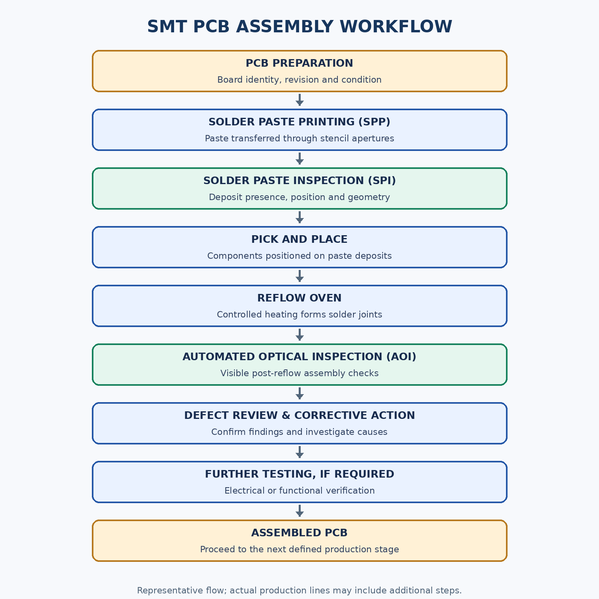
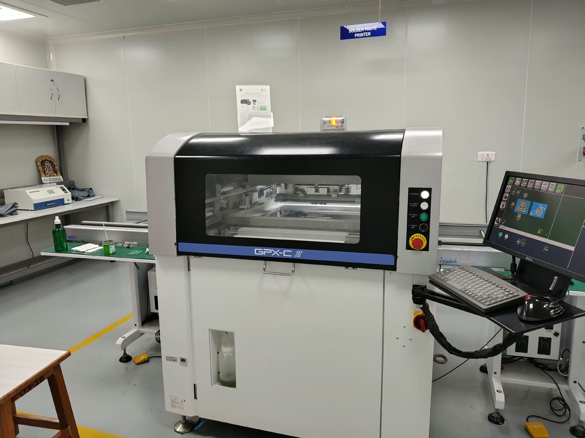
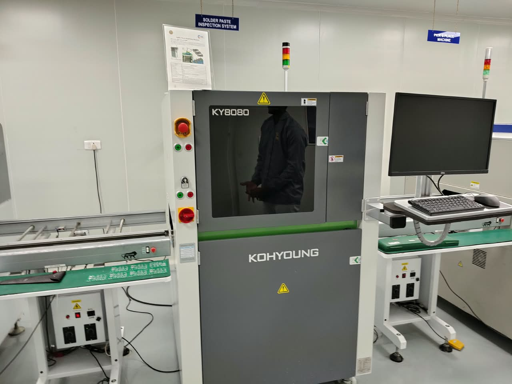
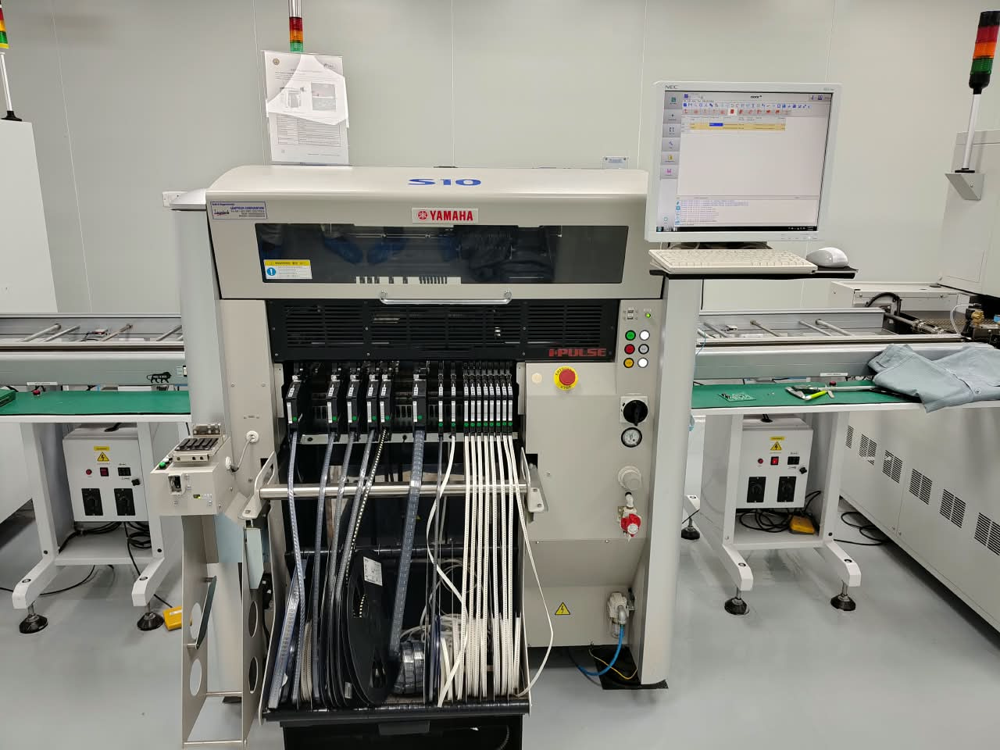

# IIT Madras — Week 2: SMT Manufacturing Learning

Technical documentation of my Week 2 learning during the **Advanced Electronics Manufacturing Training Program** at the **Central Electronics Centre, IIT Madras**, focused on the Surface Mount Technology (SMT) fabrication line.

> **Scope:** This repository separates the learning and equipment exposure reported from the training from general technical explanations added for educational context. It does not claim unreported machine operation, process settings, measurements, experiments, or production results.

## Contents

- [Training context](#training-context)
- [Learning objectives](#learning-objectives)
- [SMT workflow](#smt-workflow)
- [Equipment gallery](#equipment-gallery)
- [Technical documentation](#technical-documentation)
- [Key takeaways](#key-technical-takeaways)
- [Skills and concepts explored](#skills-and-concepts-explored)
- [References](#references-and-further-reading)
- [Acknowledgement](#acknowledgement)
- [Scope and disclaimer](#scope-and-disclaimer)

## Training context

| Item | Details |
|---|---|
| Program | Advanced Electronics Manufacturing Training Program |
| Institution | IIT Madras |
| Training location | Central Electronics Centre, IIT Madras |
| Learning period | Week 2 |
| Topic | SMT fabrication and PCB assembly |
| Exposure reported | Hands-on exposure to the SMT line and learning about its assembly stages |

### Learning objectives

1. Understand the role of SMT in modern printed circuit board assembly.
2. Explain how solder paste printing, solder paste inspection, component placement, reflow soldering, and AOI fit together.
3. Recognise common assembly defects and understand why process control matters.
4. Build a structured technical reference from the learning experience.

## SMT workflow

Editable source: [`diagrams/smt-process-flowchart.mmd`](diagrams/smt-process-flowchart.mmd)

The sequence shown is a representative workflow. Actual lines may include additional inspections, cleaning, testing, routing, traceability, or other stages depending on the product and factory process.

## Equipment gallery

| Equipment identified from the photograph | Role in the line | Photograph |
|---|---|---|
| GPX-C II solder paste printer | Deposits solder paste through a stencil onto PCB pads |  |
| Koh Young KY8080 solder paste inspection system | Inspects printed solder paste deposits |  |
| Yamaha S10 pick-and-place machine | Places surface-mount components onto the PCB |  |

The machine names above are based on visible labels in the supplied photographs. The images document the equipment appearance; they do not establish machine configuration, exact specifications, operating settings, or that a particular production run was performed.

## Technical documentation

| Document | What it covers |
|---|---|
| [01 — Introduction to SMT](docs/01-introduction-to-smt.md) | SMT fundamentals, comparison with through-hole assembly, applications |
| [02 — Solder Paste Printing](docs/02-solder-paste-printing.md) | Paste, stencil, squeegee, print sequence, parameters, defects |
| [03 — Solder Paste Inspection](docs/03-solder-paste-inspection.md) | 2D/3D inspection, measurements, defects, SPI vs AOI |
| [04 — Pick and Place Machine](docs/04-pick-and-place-machine.md) | Feeders, nozzles, recognition, alignment, placement quality |
| [05 — Reflow Soldering](docs/05-reflow-soldering.md) | Thermal stages, profiles, process considerations, defects |
| [06 — Automated Optical Inspection](docs/06-automated-optical-inspection.md) | Optical inspection principles, checks, limits |
| [07 — Complete SMT Workflow](docs/07-complete-smt-workflow.md) | Stage-by-stage workflow and process dependencies |
| [08 — Quality Control and Defects](docs/08-quality-control-and-defects.md) | Defect reference table and investigation principles |
| [09 — Key Learnings](docs/09-key-learnings.md) | Summary of learning and process relationships |
| [10 — Glossary](docs/10-glossary.md) | SMT and PCB assembly terminology |

## Key technical takeaways

- SMT assembly is a connected process: errors early in the line can affect downstream stages.
- Solder paste printing quality strongly influences the quality of the final solder joints.
- SPI provides feedback about paste deposits before components are placed.
- Placement accuracy depends on board registration, component recognition, machine setup, and correct component data.
- Reflow must be controlled using a profile appropriate to the solder paste, PCB, and components.
- AOI is useful for visible assembly defects, but it cannot verify every electrical or hidden-joint condition.
- Defect correction should follow evidence-based investigation rather than assuming a single cause.

## Skills and concepts explored

- SMT production-line architecture
- PCB assembly process sequence
- Solder paste printing and inspection concepts
- Automated component placement
- Reflow soldering principles
- Optical inspection and defect review
- Manufacturing quality control and process interdependence
- Technical documentation and engineering terminology

These are learning topics, not a claim of independent qualification to operate or maintain industrial equipment.

## References and further reading

- [Resources and manufacturer references](resources/references.md)
- [Suggested further reading](resources/further-reading.md)

Manufacturer documentation and standards should be consulted for production decisions. This repository is an educational overview and is not a substitute for controlled work instructions, equipment manuals, or applicable standards.

## Acknowledgement

I acknowledge **IIT Madras** and the **Central Electronics Centre** for the learning opportunity provided through the Advanced Electronics Manufacturing Training Program. This repository records my Week 2 learning and is intended to support continued study.

## Scope and disclaimer

This repository is an independent educational record created by a student. **It is not official IIT Madras documentation and has not been represented as approved by IIT Madras.** The general process explanations are educational summaries. The supplied photographs are included as records of the equipment visible during the learning experience. No confidential process parameters or machine settings are intentionally documented.
